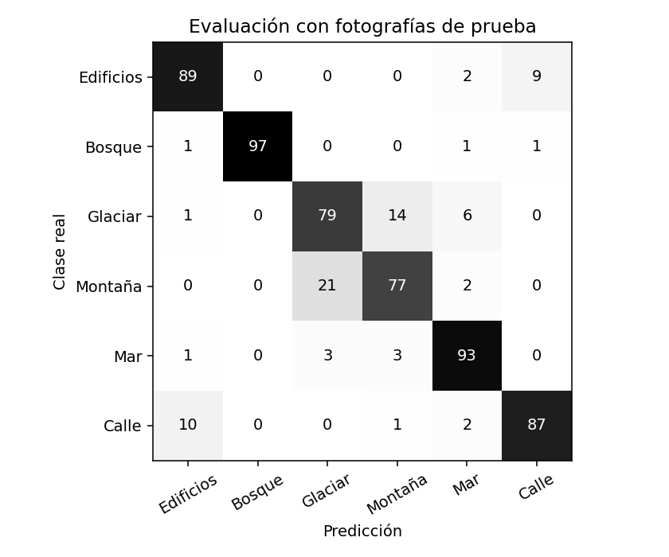

# Clasificación de paisajes y escenas

**Iris Giselle Balderas Arreola · A01752895**

Se implementó un modelo de clasificación de imágenes con Keras y TensorFlow. A partir de una fotografía se predice una de seis clases: edificios, bosque, glaciar, montaña, mar o calle.

Se utilizó [Intel Image Classification, versión 2](https://www.kaggle.com/datasets/puneet6060/intel-image-classification), publicado en Kaggle por Puneet Bansal a partir del desafío de Intel en Analytics Vidhya. Se trata de fotografías reales. Se revisaron las 13 presentaciones proporcionadas y se eligieron convoluciones, pooling, aumento de datos, regularización y transferencia de aprendizaje para esta tarea.

## Desarrollo y resultados

Se entrenó primero una CNN pequeña con Conv2D y MaxPooling. Después se utilizó MobileNetV3Small (`alpha=0.75`) con pesos preentrenados y base congelada. Se entrenó una nueva salida de seis clases con dropout y L2. En la segunda configuración se añadió una copia reflejada horizontalmente de cada imagen de entrenamiento. Validación y prueba no se aumentaron.

| Modelo y conjunto | Accuracy | F1 macro |
| --- | ---: | ---: |
| CNN inicial · validación | 67.92% | 0.6820 |
| Modelo ajustado · validación | 88.12% | 0.8812 |
| Modelo final · prueba | 87.00% | 0.8700 |

Se seleccionó el modelo por F1 macro de validación y después se evaluó una sola vez con prueba. El conjunto de prueba no se utilizó para ajustar arquitectura, pesos o hiperparámetros.



## Datos y separación

Se revisaron 17,034 imágenes etiquetadas. Se retiraron 31 filas por copias exactas o pertenecer a grupos con etiquetas contradictorias. Quedaron 17,003 imágenes únicas. La auditoría se realizó por contenido RGB, no solamente por nombre de archivo.

Para mantener el entrenamiento corto se tomó una muestra aleatoria balanceada con semilla 42: **1800 imágenes para entrenamiento, 480 para validación y 600 para prueba**. Se utilizaron las seis clases. Entrenamiento y validación se obtuvieron de la carpeta oficial de entrenamiento; prueba se obtuvo de la carpeta oficial de prueba. Se verificó que no compartieran hashes.

Las métricas corresponden a esta muestra, no a la evaluación de todo el dataset. Los manifiestos de auditoría y particiones están incluidos en `resultados/`. Las imágenes completas se descargan desde el notebook; no es necesario distribuir toda la colección para ejecutar las predicciones.

## Archivos

| Archivo o carpeta | Contenido |
| --- | --- |
| `reporte_escenas.ipynb` | Reporte con Introducción, Datos, Desarrollo del modelo, Ajuste del modelo, Resultados, Conclusiones y Aplicación |
| `modelos/modelo_final.keras` | Arquitectura completa y pesos del modelo final |
| `modelos/inicial.keras` | CNN inicial entrenada |
| `modelos/ajustado.keras` | Segundo modelo entrenado |
| `modelos/clases.json` | Orden de clases, nombres y tamaño de entrada |
| `predecir.py` | Función y aplicación por consola para una fotografía nueva |
| `ejemplos/` | Seis imágenes del test y una imagen sin etiqueta para demostración |
| `resultados/` | Métricas, historiales, gráficas, auditoría y predicciones |
| `datos/FUENTE.md` | Fuente, versión y atribución del dataset |
| `requirements.txt` | Dependencias utilizadas |

Todas las celdas de código del notebook tienen las salidas guardadas. El reporte se puede consultar sin volver a entrenar.

## Ejecutar una predicción

Se recomienda Python 3.11 o 3.12. El proyecto se verificó con Python 3.12 y TensorFlow 2.20 en CPU. Desde la carpeta del proyecto:

```bash
python -m venv .venv
```

Activar el entorno en Windows PowerShell:

```powershell
.venv\Scripts\Activate.ps1
```

O en macOS y Linux:

```bash
source .venv/bin/activate
```

Instalar y ejecutar:

```bash
python -m pip install -r requirements.txt
python predecir.py ejemplos/forest.jpg
```

Para una imagen propia:

```bash
python predecir.py "ruta/a/mi_fotografia.jpg"
```

También se puede usar desde Python:

```python
from predecir import predecir_imagen
print(predecir_imagen("ejemplos/sea.jpg"))
```

Se devuelve la escena, la clase del dataset y las puntuaciones de las seis clases. La función corrige la orientación, convierte a RGB y redimensiona a 128 × 128. El reescalado de píxeles está dentro del modelo.

**Para usar el modelo final no hace falta descargar el dataset ni entrenar nuevamente.** Las puntuaciones softmax no se calibraron como probabilidades de acierto. Una imagen que no pertenezca a las seis categorías también recibirá una de esas etiquetas.

## Reproducir el notebook

Abrir `reporte_escenas.ipynb` con un entorno de Jupyter, por ejemplo la extensión de VS Code, seleccionar el entorno de Python y ejecutar las celdas en orden. La carpeta de trabajo debe ser esta misma.

La primera ejecución descarga aproximadamente 350 MB desde Kaggle y los pesos preentrenados de MobileNetV3Small. Después reutiliza los datos locales. Si la API de Kaggle solicita autenticación o deja de responder, descargar manualmente la versión 2 del dataset y extraerla en `datos/imagenes/`, de modo que allí se encuentren `seg_train/`, `seg_test/` y `seg_pred/`, con sus subcarpetas originales.

Se fijaron la semilla, el muestreo y las versiones de dependencias. Los resultados pueden variar entre plataformas. Los tiempos medidos están en `resultados/comparacion_validacion.csv`; no incluyen la auditoría ni toda la lectura de imágenes. Volver a ejecutar reemplaza modelos y resultados.

## Sobreajuste y limitaciones

La CNN inicial todavía mostraba margen de mejora al terminar sus 12 épocas. En el modelo ajustado, la menor pérdida de validación se obtuvo en la época 10. Early stopping detuvo el entrenamiento en la 15 y recuperó esos pesos. La pérdida de entrenamiento siguió bajando mientras validación se estabilizaba, por lo que no se afirma ausencia total de sobreajuste.

El segundo experimento modificó arquitectura, preentrenamiento, regularización, aumento y duración de entrenamiento. La mejora corresponde a esa configuración completa; no se aisló el aporte individual de cada cambio.

La revisión de hashes elimina copias exactas, pero no todas las fotografías parecidas o del mismo lugar. No se evaluó con una colección externa etiquetada ni con varias semillas. Algunas fotos contienen elementos de varias clases. Las mejoras propuestas incluyen ampliar la muestra, separar por similitud visual, recopilar fotos nuevas y probar fine tuning utilizando únicamente validación para decidir.

## Referencias

- Puneet Bansal. [Intel Image Classification](https://www.kaggle.com/datasets/puneet6060/intel-image-classification), versión 2. Fuente original: Intel / Analytics Vidhya.
- Keras. [MobileNetV3](https://keras.io/api/applications/mobilenet/mobilenet_models/) y [transferencia de aprendizaje](https://keras.io/guides/transfer_learning/).
- Las 13 presentaciones del módulo, cuya relación con el proyecto se documenta al final del notebook.
